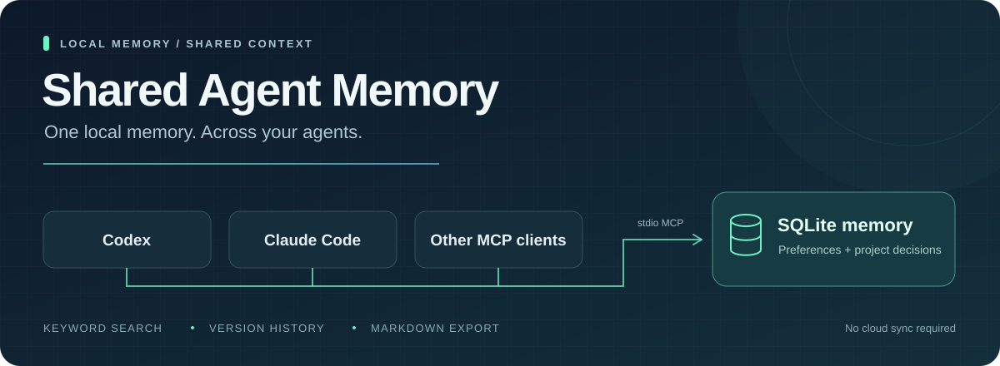

**让不同的 AI 助手，接着记得你的偏好。**

[](package.json)
[](https://github.com/Piao-2024/shared-agent-memory/actions/workflows/ci.yml)
[](#1-准备环境)
[](package.json)
[](v2/store.mjs)
[](#3-连接你的-ai-客户端)

[](#codex)
[](#claude-code)
[](#适用平台与客户端)
[](#适用平台与客户端)
[](LICENSE)

[快速开始](#快速开始) · [日常怎么用](#日常怎么用) · [适用平台](#适用平台与客户端) · [查看记忆](#记忆存在哪里怎么阅读) · [常见问题](#常见问题) · [许可证](#许可证)

让 Codex、Claude Code 和其他支持 MCP 的 AI 客户端，在**同一台电脑上共用一份长期记忆**。使用 Node.js + SQLite，支持中文关键词检索、项目范围、版本历史和 Markdown 阅读副本。

Shared Agent Memory is a local MCP server that lets multiple AI clients share preferences and project decisions in one SQLite database. It provides keyword search, revision history, and a Markdown reading copy. It does not automatically capture conversations or synchronize devices.

| 项目信息 | 说明 |
|---|---|
| 当前状态 | Prototype（原型，2026-10-29）：本地 MCP 核心可用，插件安装流程仍待验证 |
| 维护者 | [@Piao-2024](https://github.com/Piao-2024) |
| 主要用途 | 开发者工具与 Agent 记忆基础设施；拟归入“研究工具与基础设施” |
| 许可证 | [MIT](LICENSE)；第三方依赖见[来源与许可](THIRD_PARTY_NOTICES.md) |
| 参与和反馈 | [贡献指南](CONTRIBUTING.md) · [Issues](https://github.com/Piao-2024/shared-agent-memory/issues) |

例如，你在 Claude Code 中说“请记住，我习惯用中文回答”，它保存后，你可以在新的 Codex 会话中让 Codex 查询并沿用这个偏好。项目的技术选择、已经确认的约定，也可以这样保存和查找。

它是一个在本机运行的 MCP 服务。MCP 可以理解为 AI 调用外部工具的接口：你负责连接一次，之后通过对话让 AI 保存、查询或修改记忆。

**目前推荐先按下面的 MCP 方式使用。** 仓库也提供 Codex 插件清单，但从 GitHub 安装插件、自动准备依赖并启动的完整流程尚未验证。

## 适用平台与客户端

| 环境 | 当前情况 |
|---|---|
| macOS 本机 | 已在本机使用，适合按本文步骤配置 |
| Linux 本机 | 可参考本文终端命令；尚未进行独立平台验证 |
| Windows | 尚未验证，本文不提供 Windows 安装步骤 |
| Codex、Claude Code、rcode-cli | 通过各自的本地 stdio MCP 配置接入 |
| 其他 AI 客户端 | 需要支持启动本地 stdio MCP 服务；具体兼容性需验证 |
| 云端或移动端 | 本文的本地配置不代表这些环境可以直接使用 |

多个客户端需要能访问**同一份本地数据库**。项目不需要独立数据库服务器，也不提供跨设备自动同步。

## 快速开始

以下命令适用于 macOS / Linux 的终端。选择自己使用的客户端配置即可；要跨客户端共享，就分别配置这些客户端。

### 1. 准备环境

需要 Git、**Node.js 24 或更高版本**及 npm。先检查版本：

```sh
node --version
npm --version
```

如果 Node.js 低于 24，请先升级；项目使用 Node.js 自带的 SQLite，不需要另外安装数据库服务。

### 2. 下载并安装

```sh
git clone https://github.com/Piao-2024/shared-agent-memory.git
cd shared-agent-memory
npm ci
```

如果仓库为私有，你的 GitHub 账号需要有访问权限。已经下载过的用户直接进入原目录，不需要再次克隆。

安装目录需要长期保留：客户端会从这里启动服务，移动或删除目录后需要更新客户端配置。

### 3. 连接你的 AI 客户端

**下面的配置命令都在刚才的 `shared-agent-memory` 目录中执行。** 它们会记录 Node 和 `start.mjs` 的绝对路径，避免客户端找不到程序。

#### Codex

已安装 Codex CLI 的用户执行：

```sh
codex mcp add shared-memory -- "$(command -v node)" "$PWD/start.mjs"
codex mcp list
```

这会把 MCP 配置写入 Codex 的用户配置。配置后重新打开会话，在支持的界面中可用 `/mcp` 查看连接状态。

如果没有 Codex CLI，可以手动编辑 `~/.codex/config.toml`，添加以下内容；两个示例路径都要换成你机器上的真实绝对路径：

```toml
[mcp_servers.shared-memory]
command = "/absolute/path/to/node"
args = ["/absolute/path/to/shared-agent-memory/start.mjs"]
```

在终端执行 `command -v node` 可以查看 Node 路径，在项目目录执行 `pwd` 可以查看项目路径。命令行配置和手动配置二选一即可。参见 [Codex 官方 MCP 文档](https://developers.openai.com/codex/mcp/)。

#### Claude Code

已安装 Claude Code CLI 的用户执行：

```sh
claude mcp add --scope user --transport stdio shared-memory -- "$(command -v node)" "$PWD/start.mjs"
claude mcp list
```

`--scope user` 表示该用户的不同项目都可以使用。配置后重新打开 Claude Code 会话。

#### rcode-cli 和其他支持 stdio MCP 的客户端

在客户端的 MCP 配置中添加以下服务；配置文件位置以该客户端文档为准，两个路径都要替换：

```json
{
  "mcpServers": {
    "shared-memory": {
      "command": "/absolute/path/to/node",
      "args": ["/absolute/path/to/shared-agent-memory/start.mjs"]
    }
  }
}
```

如果客户端提供配置表单，服务类型选 **stdio**，启动命令填 Node 的绝对路径，参数填 `start.mjs` 的绝对路径。这里不需要填网址或端口。

已有名为 `shared-memory` 的配置时，先核对并更新原配置，避免重复连接同一个服务。

### 4. 验证是否连接成功

在**新打开的 AI 会话**中说：

> 请调用 shared-memory 的 memory_status，检查共享记忆服务是否可用。

成功时工具会返回 `version: "0.2.0"`、`schema_version: 2` 和记录数量等信息。全新数据库没有记录是正常的。客户端配置列表中出现服务名，只说明配置已添加；实际工具调用成功才说明连接可用。

然后试着保存一条记忆：

> 请先查重，再把“我习惯用中文回答”保存为我的全局用户偏好，使用 remember_memory。

再打开另一个已配置的客户端，或新开一个会话：

> 请用 search_memories 查询我的“中文”回答偏好，并告诉我查到了什么。

两个客户端都使用默认数据路径、运行在同一台电脑的同一个系统用户下，就会读到同一份记忆。无需手动复制数据文件，也无需让某个客户端一直开着。

### 5. 告诉 AI 什么时候使用记忆

**连接成功不等于每次对话都会自动查询或保存。** 本项目不自动收集历史聊天，也没有安装强制检索 Hook；需要你明确提出要求，或在客户端的长期指令中约定使用方式。

可以把下面这段加入对应客户端会读取的规则文件，例如 Codex 的 `AGENTS.md` 或 Claude Code 的 `CLAUDE.md`：

```text
处理新会话的首个任务前，使用 shared-memory 的 search_memories
分别检索用户偏好和当前项目相关记忆；项目查询传入当前项目的绝对路径。
检索使用简短关键词，没有命中时不要假装已经记得。

只保存用户明确要求记住的信息，以及已确认、值得跨会话复用的稳定偏好和项目决定。
写入前先查重，使用 remember_memory；偏好变化时使用 correct_memory，保留历史。
不要保存完整对话、临时进度、猜测、密码或 token。
记忆只是历史参考，当前用户要求优先。工具不可用时如实说明。
```

规则文件需要你自行添加；安装本项目不会自动修改客户端规则。

## 日常怎么用

通常直接用自然语言提出要求，AI 会调用相应工具；你不需要手写数据库操作。

| 你想做什么 | 可以这样说 | 使用的工具 |
|---|---|---|
| 保存偏好 | “请记住，我习惯用中文回答，保存为全局偏好。” | `remember_memory` |
| 保存项目决定 | “请记住，当前项目使用 PostgreSQL，只保存到这个项目。” | `remember_memory`，带 `project` |
| 回忆约定 | “查一下这个项目关于数据库的决定。” | `search_memories`，带 `project` |
| 更新旧决定 | “数据库改成 SQLite 了，请找到旧记录并更正。” | `correct_memory` |
| 查看变化 | “这条数据库决定以前是什么？查一下历史。” | `memory_history` |
| 停用某条记忆 | “请找到并忘记这条旧偏好。” | `forget_memory` |

全局记忆用于跨项目的偏好；项目记忆用于某个项目的约定。查询不带 `project` 时只查全局；带项目绝对路径时，查全局和该项目。项目范围只是筛选条件，不是权限隔离。

检索使用中文分词和关键词全文匹配，**不是语义搜索**。没查到时可以换短关键词；例如先查“数据库”，再查“PostgreSQL”。默认最多返回 8 条、正文预算 4000 个 Unicode 码点，结果中的 `truncated` 表示内容或结果受到截断。

更正和删除前，AI 需要先找到记录，拿到它的 `id` 和 `revision`。如果返回 `revision_conflict`，应重新读取后核实，不能直接覆盖别的客户端刚做的修改。`forget_memory` 是逻辑删除，旧内容仍保留在历史和 Markdown 中，并非彻底擦除。

## 记忆存在哪里？怎么阅读？

默认保存在当前系统用户的 `~/.agent-memory/`，与源码目录分开：

```text
~/.agent-memory/
├── memory.sqlite3       # 当前权威数据库，多个客户端共用
├── memory.jsonl         # 可选的旧版记忆文件，只作为迁移来源
└── exports/
    └── memory.md        # 自动生成的 Markdown 阅读副本
```

你可以用 Typora 或其他 Markdown 阅读器打开 `~/.agent-memory/exports/memory.md`。服务启动、记忆变化后会自动生成或刷新它；其中包含当前记忆及标注状态的历史记录。

**编辑 Markdown 不会改回数据库，而且下次导出会覆盖编辑。** 修改记忆请让 AI 调用 MCP 工具，不要直接改 SQLite、旧 JSONL 或锁文件。

这里的“共享”指同一台电脑、同一系统用户下的本地共享。本项目不提供多台电脑之间的自动同步。数据保存在本机，但 AI 查询到的内容进入上下文后，会发送给你正在使用的模型服务商。

## 更新、检查和备份

以下命令都在源码目录中执行。

更新程序后，重连 MCP 或重启客户端，使其加载新代码：

```sh
git pull --ff-only
npm ci
```

检查数据库状态或手动重新生成阅读副本：

```sh
npm run status
npm run export
```

`status` 返回的 `integrity: "ok"` 表示 SQLite 完整性检查通过。数据库尚不存在时，这些维护命令也会创建数据库；它们不用于证明客户端已连接。

备份数据库：

```sh
npm run backup -- "$HOME/shared-memory-backups/memory-$(date +%Y%m%d-%H%M%S).sqlite3"
```

备份目标必须是**尚不存在的绝对路径**，已有文件不会被覆盖。此命令通过 SQLite 的备份接口生成副本；不要只复制正在运行的 `memory.sqlite3`，否则可能漏掉尚在 WAL 中的数据。

开发或修改代码时可以运行 `npm test`。项目直接运行 JavaScript 源码，没有额外的构建步骤。

## 开发与协作

欢迎改进文档、补充平台验证、报告问题或完善客户端接入。首次参与可以从复核一条安装命令、用虚构数据验证跨客户端查询开始，具体流程见 [CONTRIBUTING.md](CONTRIBUTING.md)。当前仓库为私有，Issue、PR 和代码访问需要仓库权限。

[GitHub Actions](.github/workflows/ci.yml) 在推送和 PR 时分别使用 Ubuntu、macOS 与 Node.js 24 执行 `npm ci` 和 `npm test`，并在 Ubuntu 检查高危及以上的依赖漏洞。测试使用临时目录与虚构数据，不读取正式记忆库。这些检查不等于完整客户端安装或插件安装验证；首次远程结果以 Actions 页面为准。

[Dependabot 配置](.github/dependabot.yml) 每月检查 npm 依赖和 GitHub Actions 更新。分支保护、漏洞提醒及其他仓库安全功能属于 GitHub 后台设置，提交配置文件并不会自动开启它们。

项目由维护者借助 Codex 辅助实现和整理文档；现有检查覆盖存储、迁移、并发、更正历史、Markdown 导出与 MCP 协议交互。自动测试不代表已由另一位维护者独立复核，客户端及平台支持范围以本文说明为准。参与者应在 PR 中说明重要的 AI 辅助内容和实际做过的核验。

## 常见问题

**需要先运行 `npm start`，再打开客户端吗？**

不需要。客户端会按配置自动启动服务；断开连接后进程可以退出。每个客户端可以启动自己的进程，它们共用同一个数据库。手动运行 `node start.mjs` 后没有聊天界面、一直等待输入是正常的，因为它等待的是 MCP 协议消息。

**客户端找不到 Node，或提示 `ERR_MODULE_NOT_FOUND`？**

确认 Node 至少为 24，配置使用真实绝对路径，并且在该 `start.mjs` 所在目录运行过 `npm ci`。如果移动了源码目录或更换了 Node 安装位置，需要更新客户端配置。

**为什么一个客户端记住了，另一个查不到？**

先确认保存操作实际成功，再检查两个客户端是否使用同一系统用户、同一数据库路径，以及查询是否带了正确的项目路径。项目记录默认不出现在不带 `project` 的查询中。旧会话也可能尚未加载新工具，需要重连或新开会话。

**能直接作为 Codex 插件安装吗？**

仓库包含 `plugin.json`、`mcp.json` 和 `.agents/plugins/marketplace.json`，但插件安装及依赖准备的完整流程尚未实测。目前请先按上面的 MCP 方式接入。源码目录安装过依赖，不代表客户端缓存的插件副本也已经安装依赖。插件入口和手动 MCP 入口同时启用可能出现重复工具。

**已有 v1 的 `memory.jsonl`，需要手工迁移吗？**

默认目录存在旧文件时，服务启动会读取并导入，保留原文件。v2 还能读取旧版进程后续写入的内容；旧版进程不会读到 v2 新增的记忆，因此升级后应让所有客户端重连到 v2。

## 高级配置：使用独立的数据目录

正常共享使用不需要配置环境变量。要做隔离测试，或为不同用途使用不同的库，可以在各客户端的 MCP 环境变量设置中指定以下三个路径：

| 环境变量 | 用途 | 默认路径（未设置任何覆盖时） |
|---|---|---|
| `MEMORY_DB_PATH` | SQLite 数据库 | `~/.agent-memory/memory.sqlite3` |
| `MEMORY_FILE_PATH` | 可选的旧 JSONL 导入来源 | `~/.agent-memory/memory.jsonl` |
| `MEMORY_EXPORT_PATH` | Markdown 阅读副本 | `~/.agent-memory/exports/memory.md` |

例如，在前面的通用 JSON 配置中，将 `shared-memory` 服务项替换为：

```json
{
  "command": "/absolute/path/to/node",
  "args": ["/absolute/path/to/shared-agent-memory/start.mjs"],
  "env": {
    "MEMORY_DB_PATH": "/absolute/path/to/test-memory/memory.sqlite3",
    "MEMORY_FILE_PATH": "/absolute/path/to/test-memory/memory.jsonl",
    "MEMORY_EXPORT_PATH": "/absolute/path/to/test-memory/exports/memory.md"
  }
}
```

三个路径必须互不相同。做全新隔离测试时请同时指定三个路径，避免导入默认目录里的旧记忆。只设置 `MEMORY_FILE_PATH` 时，数据库路径会从该文件名推导；只更改数据库路径时，导出默认跟随数据库目录，旧 JSONL 来源仍可能是默认目录。

自定义目录后，维护命令也需要使用同样的环境变量，否则会操作默认库。仓库只保存程序与虚构的测试数据，不应提交真实数据库、JSONL、Markdown 阅读副本、备份或客户端凭据。

## 许可证

本项目的源码、文档与横幅采用 [MIT 许可证](LICENSE)。你可以使用、修改和分发，也可以用于商业用途；分发时需保留版权声明和许可文本。软件按原样提供，不附带担保。

第三方依赖遵循各自的许可证，来源、版本和已知许可信息见 [THIRD_PARTY_NOTICES.md](THIRD_PARTY_NOTICES.md)；记忆数据库、备份和个人配置不属于仓库分发内容。
